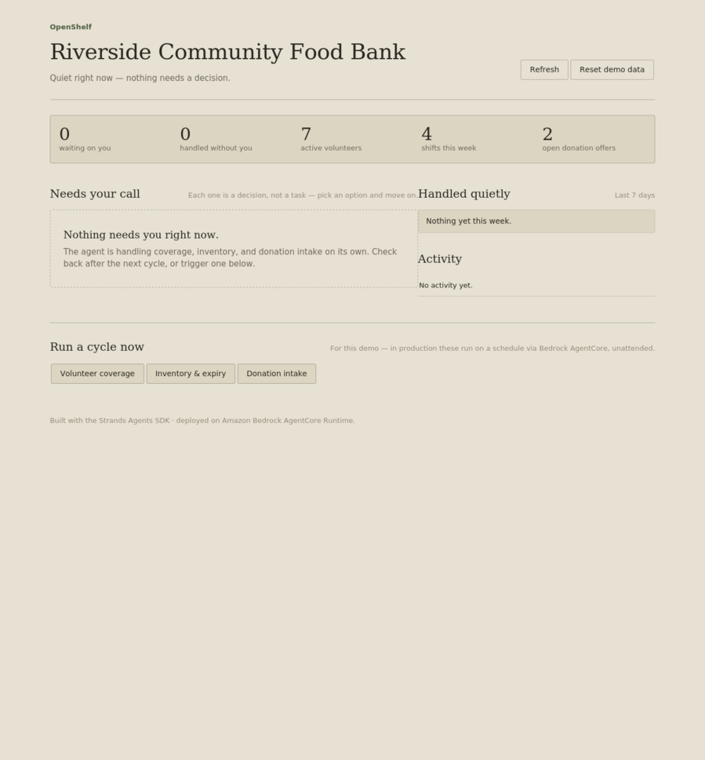
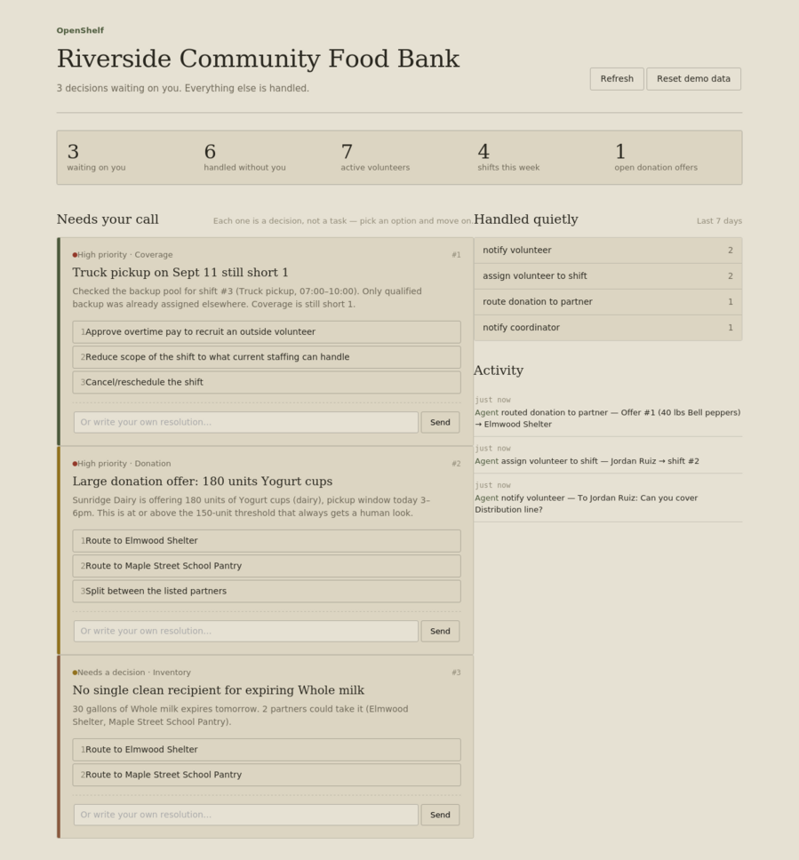
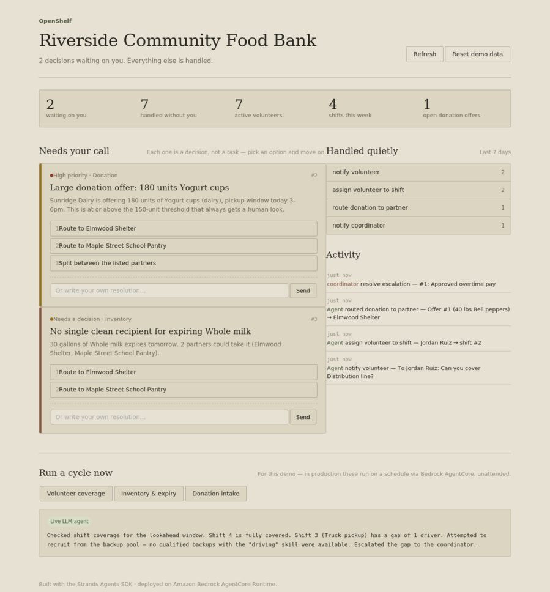

<div align="center">


# OpenShelf aloo

### **Less coordination. Less waste. More help.**

*Let the agent handle the routine.*  
*Let people handle the judgment.*

</div>

# OpenShelf

**Track:** Good Neighbor Agents — agents that help *groups* of people (neighborhoods, nonprofits, food banks, schools, libraries, small local orgs).
**Built with:** [Strands Agents SDK](https://strandsagents.com) · **Deployed on:** Amazon Bedrock AgentCore Runtime

An autonomous agent that runs in the background for a small community organization — handling routine coordination quietly, and surfacing a decision to a human only when it's a genuine judgment call.

---

## The problem

Small community organizations — food banks, mutual aid networks, shelters — run on the same handful of overworked coordinators. Every week they re-solve the same three problems by hand:

1. **"Is Saturday's shift actually covered?"** — chasing volunteers over text.
2. **"What's about to expire, and who can take it before it spoils?"** — checking a spreadsheet, then calling around.
3. **"Someone just offered us 200 lbs of produce — who should get it?"** — a judgment call made under time pressure, usually by whoever picks up the phone.

None of this needs a new dashboard to check. Coordinators want the routine 80% handled quietly, and to be pulled in only for the 20% that actually needs a human judgment call — a safety concern, a resource conflict, a threshold breach, or genuine ambiguity.

## What this is

A single autonomous agent — **OpenShelf** — that runs on a schedule in the background for a community org (demo scenario: **Riverside Community Food Bank**), watching three things:

| Cycle | What it checks | What it does on its own | What it escalates |
|---|---|---|---|
| **Volunteer coverage** | Shifts in the next N days vs. confirmed headcount | Recruits from the backup volunteer pool and auto-confirms fills | A shift stays uncovered past the safe window, or no backups exist |
| **Inventory & expiry** | Stock levels vs. thresholds, expiry dates | Logs low-stock items for reorder, routes near-expiry perishables to a partner org with capacity | Large-value shortfall, no safe recipient found, or a food-safety flag |
| **Donation intake** | New donation offers vs. partner org need/capacity | Auto-confirms a clean match (one clear best recipient with capacity) | Competing high-need recipients, unusual/large donations, allergen or condition concerns |

Every autonomous action is logged and rolled into a **weekly digest**. Every escalation is a single, specific decision — a title, the situation, and 2-3 concrete options — sent to the coordinator, formatted the way an SMS reply would work ("reply with a number"). The agent won't re-escalate the same unresolved problem every cycle — it checks for an existing pending escalation on the same underlying situation first.

---

## Screenshots

**Quiet state — nothing needs a decision:**



**After a cycle runs and finds real decisions to make:**



**After a coordinator resolves one:**




---

## What file is what

```
openshelf/
├── README.md                    — this file
├── requirements.txt              — Python dependencies
│
├── src/openshelf/                — the agent itself (this is the actual package)
│   ├── config.py                  — the "autonomy contract": every threshold that decides
│   │                                 what the agent may do alone vs. must escalate, plus
│   │                                 which model backend to use
│   ├── db.py                      — SQLite schema + connection helper + activity logging
│   ├── seed_data.py               — builds the realistic one-week demo scenario
│   ├── agent.py                   — builds the real strands.Agent: system prompt + tools
│   │                                 + which model backend (Bedrock Converse or
│   │                                 Bedrock-Mantle for Gemma 4) to call
│   ├── orchestrator.py            — runs a named cycle ("volunteers"/"inventory"/
│   │                                 "donations") against the real agent; also has a
│   │                                 simple always-on scheduler loop for local use
│   ├── deterministic_cycles.py    — a non-LLM implementation of the exact same policy,
│   │                                 used by the CLI demo and as the dashboard's fallback
│   │                                 when no Bedrock credentials are configured
│   ├── escalation.py              — read/resolve the pending-decisions queue
│   ├── digest.py                  — builds the weekly digest (markdown + HTML)
│   ├── cli.py                     — `python -m openshelf.cli ...` command-line interface
│   └── tools/                     — the actual tools the agent calls
│       ├── volunteer_tools.py      — shift coverage, backup recruiting, notifications
│       ├── inventory_tools.py      — inventory status, donation intake recording
│       ├── donation_tools.py       — partner-org matching + routing
│       └── ops_tools.py            — escalate_to_human (with dedup), notify_coordinator,
│                                      get_current_datetime
│
├── dashboard/                    — the web UI shown in the screenshots above
│   ├── server.py                  — Flask API over the *same* db/tools/escalation/digest
│   │                                 modules the agent uses — no separate data layer
│   └── static/
│       ├── index.html              — page structure
│       ├── style.css               — the matte visual design (see Design notes below)
│       └── app.js                  — fetches from the Flask API, renders escalation
│                                      cards, wires up the "run cycle" buttons
│
├── agentcore/                    — cloud deployment
│   ├── app.py                     — BedrockAgentCoreApp entrypoint (what AWS invokes)
│   ├── Dockerfile                  — container build (linux/arm64, required by AgentCore)
│   └── deploy.md                   — full step-by-step AWS deployment guide
│
├── demo/
│   ├── scripted_walkthrough.py     — runs the deterministic policy end-to-end and prints
│   │                                  every decision, no AWS credentials required
│   └── demo_transcript.md          — a captured, annotated run of the above, for judges
│
├── docs/screenshots/              — the images and GIF used in this README
│
└── tests/
    └── test_tools.py               — pytest suite covering the tool layer and the
                                       escalation dedup behavior, independent of any LLM
```

**The one thing worth understanding about the architecture:** `agent.py` (real LLM) and `deterministic_cycles.py` (hand-coded fallback) implement the **same policy** against the **same tools** and the **same database**. The dashboard and CLI both prefer the real agent and only fall back to the deterministic path when Bedrock isn't reachable — and they tell you honestly which one actually ran.

---

## Setup

```bash
git clone <this repo>
cd src
pip install -r requirements.txt
```

Build the demo database:

```bash
# Windows PowerShell
$env:PYTHONPATH = "src"
python -m openshelf.cli init-db
python -m openshelf.cli seed

# macOS/Linux
export PYTHONPATH=src
python -m openshelf.cli init-db
python -m openshelf.cli seed
```

---

## How to start the dashboard server

```bash
python dashboard/server.py
```

(`dashboard/server.py` already adds `src` to its own path, so you don't need `PYTHONPATH` set just for this.)

Then open **http://localhost:5050** in your browser. You'll see the quiet-state view first (matches the first screenshot above) until you either wait for the demo data's built-in gaps to matter, or trigger a cycle yourself from the **"Run a cycle now"** panel at the bottom of the page.

Every button click hits the real Flask API — resolving an escalation, resetting demo data, and running a cycle all write to the same SQLite database the CLI uses.

---

## How to run the live LLM agent

The dashboard and CLI will always *try* the real agent first. To make that succeed instead of silently falling back to the deterministic path, you need AWS credentials with Bedrock access configured.

### 1. Configure AWS credentials (one-time)

```bash
aws configure
```
Enter your Access Key ID, Secret Access Key, region (e.g. `us-east-1`), and output format (`json`). Get the keys from **IAM → Users → your user → Security credentials → Create access key** in the AWS Console — create a dedicated IAM user with `AmazonBedrockFullAccess` rather than using root account keys.

Verify it worked:
```bash
aws sts get-caller-identity
```

### 2. Choose your model backend

OpenShelf supports two ways of reaching a Bedrock-hosted model, controlled by env vars in `config.py`:

**Standard Bedrock Converse API** (Claude, Llama 3.x/4, Mistral, Cohere, Gemma 3):
```bash
$env:OPENSHELF_MODEL_PROVIDER = "bedrock"
$env:OPENSHELF_MODEL_ID = "us.meta.llama4-scout-17b-instruct-v1:0"   # example
$env:AWS_REGION = "us-east-1"
```

**Bedrock-Mantle** (Gemma 4 family only — E2B, 26B-A4B, 31B — served via a separate OpenAI-compatible endpoint):
```bash
$env:OPENSHELF_MODEL_PROVIDER = "bedrock-mantle"
$env:OPENSHELF_MODEL_ID = "google.gemma-4-31b"   # this is the current default in config.py
$env:AWS_REGION = "us-east-1"
```
(macOS/Linux: use `export VAR=value` instead of `$env:VAR = "value"`.)

If you don't set these at all, `config.py`'s defaults already point at `bedrock-mantle` + `google.gemma-4-31b`.

### 3. Run it

**From the CLI**, so you can read the actual tool-call sequence:
```bash
python -m openshelf.cli run-cycle volunteers
```
A working run prints each tool call the model made (`get_current_datetime`, `get_shift_coverage`, `find_available_backup_volunteers`, `escalate_to_human`, etc.) followed by a plain-language summary — this is the real model reasoning through your tools, not a script.

Check what it actually did (don't just trust the summary text):
```bash
python -m openshelf.cli show-escalations
```

**From the dashboard**, click any button under "Run a cycle now" — the response box that appears shows a badge:
- 🟢 **"Live LLM agent"** — the real model ran successfully (this is what's shown in the third screenshot above)
- 🟡 **"Deterministic policy path (no Bedrock credentials found)"** — the fallback ran instead, and the badge text includes the actual Python exception name so you know what to fix (missing credentials, wrong region, model not enabled, etc.)

### 4. Reset between test runs

Since escalations persist until resolved, reset to a clean slate before re-testing:
```bash
python -m openshelf.cli init-db
python -m openshelf.cli seed
```
or, from the dashboard, click **"Reset demo data."**

---

## Deploying to Bedrock AgentCore

See **`agentcore/deploy.md`** for the full walkthrough: building the container, pushing to ECR, launching the AgentCore Runtime, and wiring up EventBridge Scheduler rules so the three cycles run unattended on a real schedule instead of needing anyone to trigger them.

---

## Accomplishments

- **Technological implementation** — a real `strands.Agent` with 13 purpose-built tools over a real relational datastore, explicit autonomy/escalation policy (including duplicate-escalation prevention) in the system prompt, support for multiple model backends (standard Bedrock Converse and Bedrock-Mantle for Gemma 4), a working AgentCore Runtime entrypoint, and a deterministic tool-logic path that proves the mechanics without any AWS dependency.
- **Design** — the product is designed around *not* being opened: scheduled background cycles, a once-a-week digest, and single, specific escalations instead of a chat UI to manage. The dashboard exists as a presentable window into that system, built around making the "needs your call" queue the dominant, unmissable element.
- **Potential impact** — targets a named, common failure mode (volunteer no-shows, spoiled donations, mismatched donation routing) for a concrete audience (food banks / mutual aid orgs) with a measurable output: fewer uncovered shifts, less wasted food, faster donation routing, and a bounded number of decisions actually asked of a human.

<div align="center">

### 🌾 OpenShelf

**Good Neighbor Agents that quietly get things done.**

*Less coordination. Less waste. More help.*

</div>
