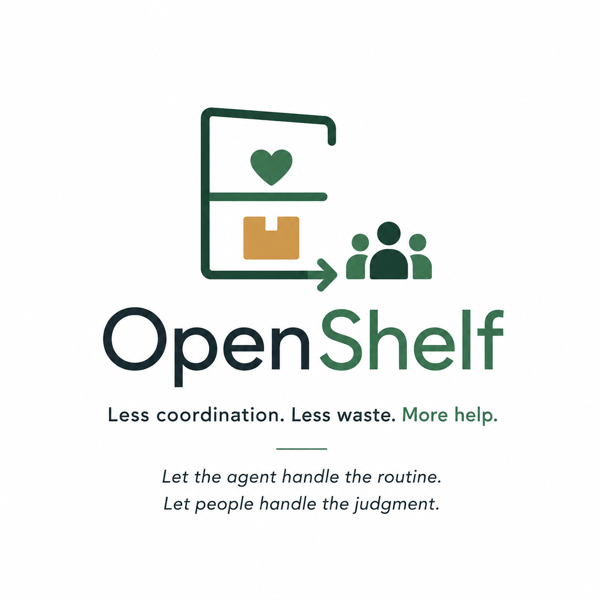
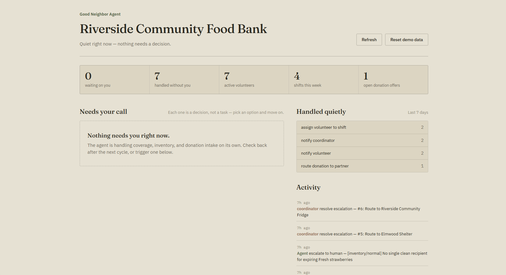
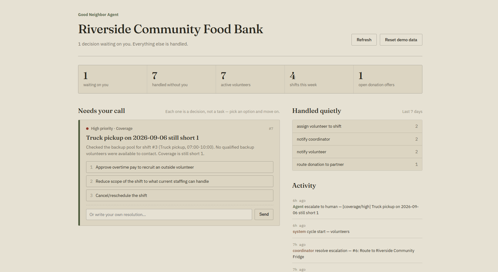
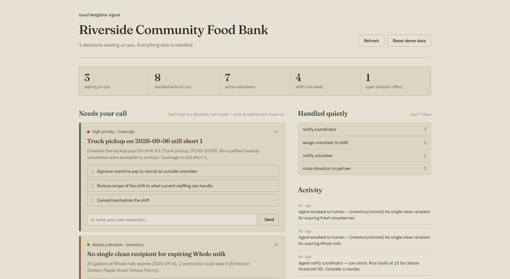
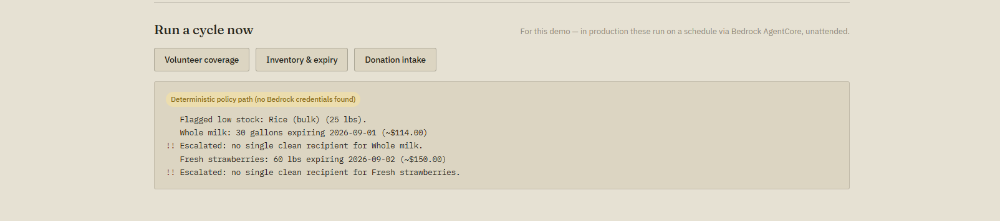

<div align="center">



# OpenShelf

### **Less coordination. Less waste. More help.**

*Let the agent handle the routine.*  
*Let people handle the judgment.*

<br>


</div>

---

## 🌾 The Problem

Small community organizations — food banks, shelters, mutual aid networks, school pantries — often run on a handful of overworked coordinators.

Every week, they re-solve the same problems by hand:

| | Problem | The manual work |
|---|---|---|
| 🧑‍🤝‍🧑 | **Volunteer coverage** | “Is Saturday's shift actually covered?” — chasing volunteers over text. |
| 📦 | **Expiring inventory** | “What's about to expire, and who can take it?” — checking spreadsheets and calling around. |
| 🤝 | **Donation routing** | “Someone offered 200 lbs of produce — who should get it?” — making rushed judgment calls. |

These problems don't need **another dashboard to babysit**.

They need the routine 80% handled quietly, with a coordinator pulled in only for the 20% that genuinely requires human judgment.

---

## 🧠 What OpenShelf Does

**OpenShelf** is an autonomous operations agent for small community organizations.

It runs in the background and watches three operational areas:

| Cycle | What it checks | What it handles autonomously | When it escalates |
|---|---|---|---|
| **Volunteer coverage** | Upcoming shifts vs. confirmed headcount | Recruits from the backup pool and confirms fills | Shift stays uncovered or no backup exists |
| **Inventory & expiry** | Stock levels, thresholds and expiry dates | Flags reorders and routes near-expiry food to partners with capacity | Large shortfall, no safe recipient, or food-safety concern |
| **Donation intake** | New offers vs. partner need/capacity | Confirms a clean match with one clear recipient | Competing high-need recipients, unusual donations, or safety concerns |

### The core design bet

> **The agent is judged by how rarely it needs you — and how good the ask is when it does.**

Everything the agent handles automatically is logged and summarized in a **weekly digest**.

Everything that needs a person becomes one specific escalation:

**Situation → context → 2–3 concrete options → decision**

No back-and-forth. No interface to learn.

---

# 🎬 Demo Showcase

A live demo of the **Riverside Community Food Bank** dashboard, showing the agent moving from a quiet state to human escalations and finally running an operational cycle.

### 01 · All clear

Nothing currently needs a coordinator. The agent is handling routine work on its own.

<p align="center">
  
</p>

---

### 02 · One decision

A volunteer coverage problem crosses the autonomy boundary, so OpenShelf gives the coordinator three concrete options.

<p align="center">
  
</p>

---

### 03 · Multiple decisions

Several issues require judgment at once, while routine work continues to be handled quietly.

<p align="center">
  
</p>

---

### 04 · Run a cycle

A coordinator can trigger a cycle for the demo. In production, these cycles run unattended through Bedrock AgentCore and a scheduler.

<p align="center">
  
</p>

---

## ⚙️ How It Works

```text
                    Scheduled cycle
                           │
                           ▼
                 ┌──────────────────┐
                 │  Strands Agent   │
                 │  + real tools    │
                 └────────┬─────────┘
                          │
                    Read real data
                          │
                          ▼
                 ┌──────────────────┐
                 │ Autonomy policy  │
                 │ Can I safely     │
                 │ decide this?     │
                 └───────┬──────────┘
                         │
              ┌──────────┴──────────┐
              ▼                     ▼
       ┌──────────────┐      ┌──────────────┐
       │ Handle       │      │ Escalate     │
       │ automatically│      │ to human     │
       └──────┬───────┘      └──────┬───────┘
              └──────────┬──────────┘
                         ▼
                  Activity log
                         │
                         ▼
                  Weekly digest
```

---

## 🔌 Why Strands?

OpenShelf is **not a thin prompt wrapper**.

It is a real `strands.Agent` equipped with purpose-built tools backed by a real SQLite datastore containing:

- volunteers
- shifts
- inventory
- partner organizations
- donation offers
- escalations
- activity logs

The system prompt defines an explicit **autonomy contract**:

- what the agent can decide alone
- what requires human approval
- which thresholds trigger escalation
- how ambiguity should be handled

The `escalate_to_human` tool is the **single channel** for surfacing decisions to a coordinator.

The agent therefore reasons over actual tool outputs, constraints and thresholds instead of simply following a fixed script.

---

## 🏗️ Architecture

```text
                         ┌──────────────────────┐
                         │ EventBridge Scheduler│
                         └──────────┬───────────┘
                                    │
                                    ▼
                         ┌──────────────────────┐
                         │   OpenShelf Agent    │
                         │   Strands + Bedrock  │
                         └──────────┬───────────┘
                                    │
                 ┌──────────────────┼──────────────────┐
                 ▼                  ▼                  ▼
          Volunteer tools    Inventory tools    Donation tools
                 └──────────────────┼──────────────────┘
                                    ▼
                              SQLite datastore
                                    │
                    ┌───────────────┴───────────────┐
                    ▼                               ▼
              Activity log                    Escalations
                    │                               │
                    ▼                               ▼
              Weekly digest                  SNS / Slack
```

---

## 🛠️ Built With

| Layer | Technology |
|---|---|
| **Agent** | Strands Agents SDK |
| **Model runtime** | Amazon Bedrock |
| **Deployment** | Amazon Bedrock AgentCore Runtime |
| **Scheduling** | Amazon EventBridge Scheduler |
| **Database** | SQLite |
| **Backend** | Python |
| **Dashboard** | Flask + HTML/CSS/JS |
| **Notifications** | SNS / Slack webhook |

---

## 📁 Project Structure

```text
src/openshelf/
│
├── config.py                 # Thresholds & autonomy policy
├── db.py                     # SQLite schema + activity logging
├── seed_data.py              # Riverside demo scenario
├── deterministic_cycles.py   # Offline policy implementation
│
├── tools/
│   ├── inventory_tools.py
│   ├── volunteer_tools.py
│   ├── donation_tools.py
│   └── ops_tools.py
│
├── agent.py                  # Strands Agent + system prompt
├── orchestrator.py           # Background cycles + scheduler
├── digest.py                 # Weekly digest
├── escalation.py             # Escalation queue
└── cli.py                    # Operations CLI

agentcore/
├── app.py
├── Dockerfile
└── deploy.md

dashboard/
├── server.py
└── static/
    ├── index.html
    ├── style.css
    └── app.js

demo/
├── scripted_walkthrough.py
└── demo_transcript.md

tests/
└── test_tools.py
```

---

## ▶️ Quick Start

### 1. Install dependencies

```bash
pip install -r requirements.txt
```

### 2. Build the demo world

```bash
python -m goodneighbor.cli init-db
python -m goodneighbor.cli seed
```

### 3. Run the offline walkthrough

No AWS credentials required:

```bash
python demo/scripted_walkthrough.py
```

### 4. Start the dashboard

```bash
python dashboard/server.py
```

Then open:

```text
http://localhost:5050
```

### 5. Run a real agentic cycle

Requires AWS credentials with Bedrock access:

```bash
export AWS_REGION=us-east-1

python -m goodneighbor.cli run-cycle all
```

### 6. Inspect escalations

```bash
python -m goodneighbor.cli show-escalations
```

### 7. Generate the weekly digest

```bash
python -m goodneighbor.cli digest
```

---

## ☁️ Deploying to Bedrock AgentCore

OpenShelf is designed to run **without someone opening the app**.

`agentcore/app.py` wraps the same OpenShelf agent in a `BedrockAgentCoreApp`, containerized through `agentcore/Dockerfile`.

In production:

```text
EventBridge Scheduler
        │
        ├── Volunteer coverage
        ├── Inventory & expiry
        └── Donation intake
                    │
                    ▼
          Bedrock AgentCore
                    │
                    ▼
              OpenShelf
                    │
          ┌─────────┴─────────┐
          ▼                   ▼
   Handle quietly       Escalate clearly
                              │
                              ▼
                         Coordinator
```

Escalations are pushed through **SNS / Slack webhook** — the main time the organization hears from the agent unprompted.

See `agentcore/deploy.md` for deployment instructions.

---

## 📊 Why It Matters

| Today | With OpenShelf |
|---|---|
| Volunteers chased manually | Backup pool recruited automatically |
| Food checked manually | Expiry risks detected continuously |
| Donations routed under pressure | Clear matches handled automatically |
| Coordinators monitor dashboards | Agent works in the background |
| Every problem reaches a person | Only genuine judgment calls do |

### The goal

**↓ uncovered shifts**  
**↓ wasted food**  
**↓ routing delays**  
**↓ coordinator workload**

OpenShelf doesn't replace the people running these organizations.

It gives them more time to do the work **only people can do**.

---

## What all is it :-

### Technological implementation

- Real `strands.Agent`
- 13 purpose-built tools
- SQLite relational datastore
- Explicit autonomy and escalation policy
- AgentCore Runtime entrypoint
- Scheduled background execution
- Deterministic offline demo path
- Shared logic between agent, CLI and dashboard

### Design

- Background-first instead of dashboard-first
- Weekly digest instead of constant notifications
- Single, specific human escalations
- Dashboard centered around **Needs your call**
- SMS-style decision format
- Matte olive / clay / mustard / brick visual language

### Potential impact

OpenShelf targets measurable operational failures:

**↓ uncovered shifts** · **↓ food waste** · **↓ routing delays** · **↓ coordinator workload**

---

<div align="center">

### 🌾 OpenShelf

**Good Neighbor Agents that quietly get things done.**

*Less coordination. Less waste. More help.*

</div>